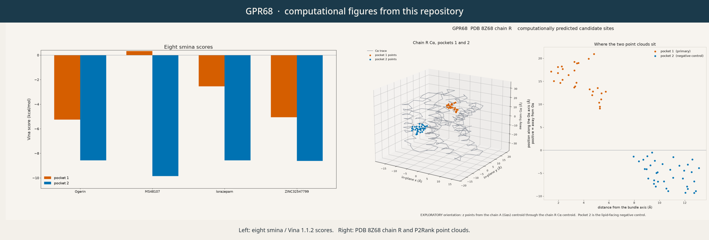
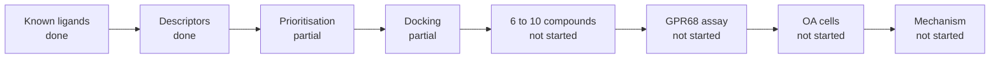
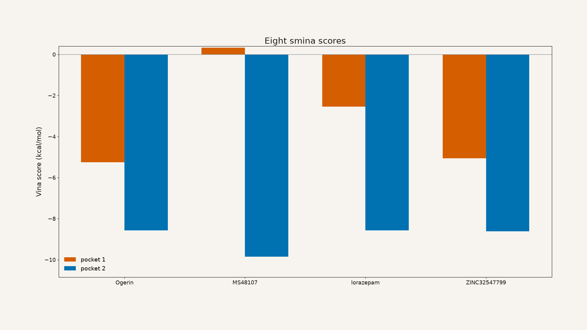
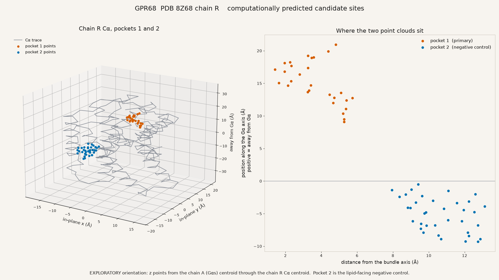
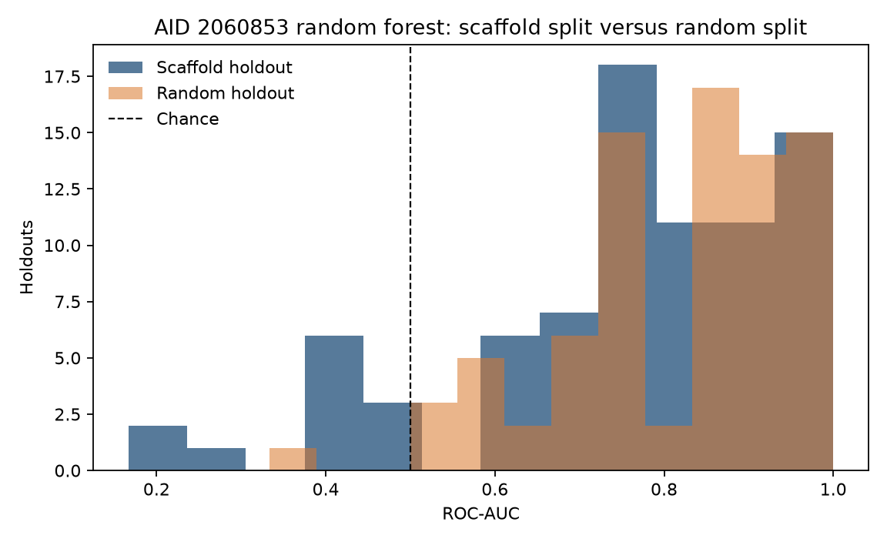
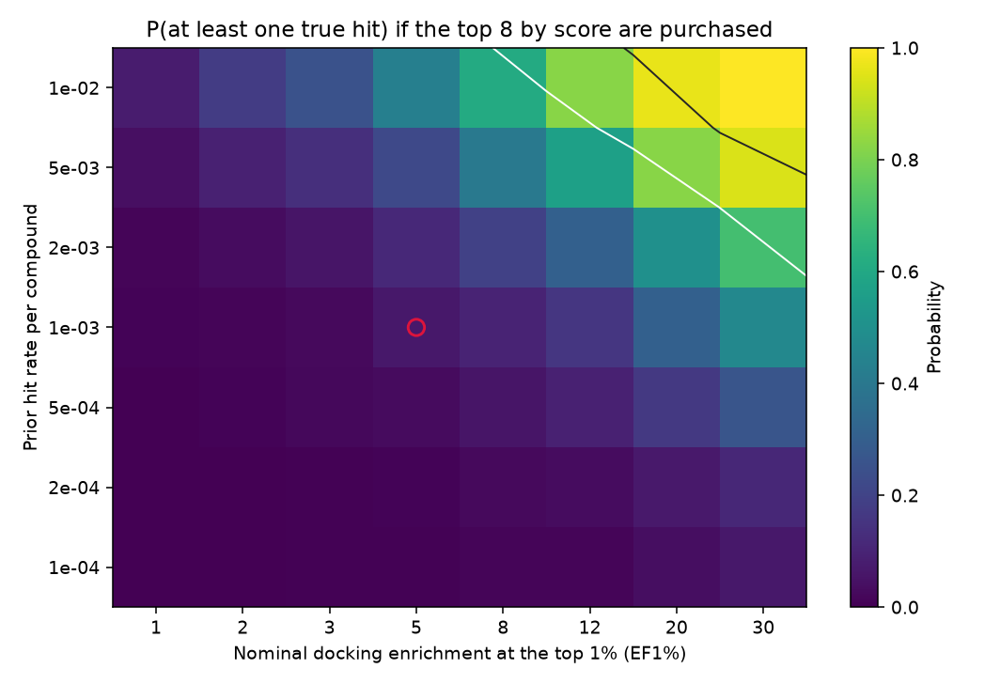

# AI-assisted discovery of GPR68 modulators for osteoarthritis

**AI-Assisted Discovery of Novel Small-Molecule Modulators of GPR68 for Cartilage Protection in Osteoarthritis**

人工智能辅助发现新型 GPR68 小分子调节剂用于骨关节炎软骨保护

This project is listed by the Student Union of the International School of Medicine, Zhejiang University. The competition is the East China region, undergraduate group, track 3: virtual screening of small-molecule drugs for ion channels, GPCRs, and other drug targets.

<p align="center">
  
</p>

Composite of two computational figures already in this repository: eight smina/Vina scores on the left, and the PDB 8Z68 chain-R pocket topology on the right. Repository maintainers assembled the banner from figures made by Bogdan Kochergin. The measured numbers are in the tables below.

## Status

The ligand library and the candidate pockets are prepared.

The GNINA redock is technical validation only.

The known-ligand GNINA benchmark and the wet lab are not done. The smina eight-run is a later computational check, on a different engine.

## Team

The five student members are in year 4, Clinical Medicine. Names and roles follow the competition team form.

| Name | Role |
| --- | --- |
| Vineth Vimukthi Wickremasinghe, team leader | Project design, literature review, research coordination, report integration, and overall supervision of progress |
| Shah Vaishvi Abhinav | Ligand dataset curation, molecular descriptors, machine-learning model development, and candidate prioritization |
| Christine Carleone Winata | Receptor structure preparation, pocket prediction, molecular docking, benchmark analysis, and structural visualization |
| Ye Linn Phyoe | Experimental design, receptor functional assays, chondrocyte validation strategy, and biological interpretation |
| Amoz Thomas Zhao-En Chin | Data visualization, figure preparation, report editing, result integration, and presentation |

Bogdan Kochergin contributed code, simulations, and data representation. [github.com/zititank](https://github.com/zititank)

Wei Wei, Project Supervisor, Assistant Professor, Regenerative Medicine.

## Pipeline

The slide deck moves from known ligands to a mechanism study. Each box below is marked with what the files in this repository actually contain.



Known ligands are curated in the submission table and in the later reference tables. Descriptors were calculated for 10,240 library structures. Prioritisation has a machine-learning audit and no prospective ranked purchase list. Docking has a GNINA technical redock and a later smina eight-run. The planned known-ligand GNINA comparison of the two pockets is unfinished. Buying 6–10 compounds, the GPR68 assay, the osteoarthritis cell work, and the mechanism study are described as plans. The calcium and qPCR numbers in the report are planning simulations.

## Findings

### Team package

These numbers are the competition abstract and the team code package. The docking engine here is GNINA v1.3.2. This redock is a technical check. It does not establish that docking is valid for GPR68. The abstract states that the known-ligand pocket comparison is unfinished.

RDKit loaded 10,240 structures, with 0 failures and 0 duplicate canonical SMILES in that processed run. The loaded count and the mean properties are in [code/submission/results/library_summary.csv](code/submission/results/library_summary.csv). The failure and duplicate counts are stated in [code/submission/README.md](code/submission/README.md) and [code/submission/data/DATA_SOURCES.md](code/submission/data/DATA_SOURCES.md). The raw commercial SDF is not in this repository. The derived descriptor table is [code/submission/results/preliminary_results/MCE_5K_RDKit_properties.csv](code/submission/results/preliminary_results/MCE_5K_RDKit_properties.csv).

The receptor is PDB 8Z68. P2Rank pocket 1 has score 7.06, probability 0.366, and centre (145.764, 127.948, 98.930). Pocket 2 has score 6.87, probability 0.353, and centre (129.885, 132.584, 117.625). The table is [code/submission/data/GPR68_P2Rank_pockets.csv](code/submission/data/GPR68_P2Rank_pockets.csv). These are predicted sites.

The GNINA technical redock, from [code/submission/logs/GNINA_example_log.txt](code/submission/logs/GNINA_example_log.txt) and [code/submission/logs/GNINA_example_RMSD.txt](code/submission/logs/GNINA_example_RMSD.txt), reports a best RMSD of 0.594 Å (0.59408 in the log), affinity −8.51 kcal/mol, CNN pose score 0.979 (0.9790 in the log), and CNN affinity 7.160.

The one-page abstract is [paper/abstract.pdf](paper/abstract.pdf). The slides are [paper/presentation.pptx](paper/presentation.pptx).

### Later smina check

This is a separate experiment. The engine is smina, November 2017 build, Vina 1.1.2 scoring. The box is 24 Å, exhaustiveness 16, seed 1, pH 6.8, chain R. GNINA was not run for these eight jobs. The full rows are in [code/pipeline/results/docking/scores.csv](code/pipeline/results/docking/scores.csv). Best score, kcal/mol:

| Compound | Pocket 1 | Pocket 2 |
| --- | ---: | ---: |
| Ogerin | −5.258 | −8.577 |
| MS48107 | +0.332 | −9.854 |
| Lorazepam | −2.546 | −8.575 |
| ZINC32547799 | −5.064 | −8.623 |

The mean of (pocket 1 − pocket 2) is +5.77 kcal/mol. Pocket 2 was the lipid-facing negative control, and it scored better for every ligand. MS48107 at pocket 1 is positive (+0.332 kcal/mol), which means the ligand was placed with a clash. This pattern is a Vina preference for the more open groove in this active Gs-bound conformation. It does not identify pocket 2 as the proton-sensing site. It is a different experiment from the GNINA benchmark described in the slides.

The written note is [paper/FINDINGS.md](paper/FINDINGS.md). The rendered decision note is [paper/decision-report.html](paper/decision-report.html).

### Figures

The score chart is smina / Vina 1.1.2. Pocket 2 is the lower (better) bar for every compound.



The topology figure draws the chain-R Cα trace and the P2Rank point clouds for the two predicted sites. It is a geometric summary of those points. It is not a docked pose, and no docking engine produced the coordinates.



The split plot is a random-forest audit of PubChem AID 2060853. It is a ligand-based model check. Scaffold holdouts spread across the chance line. Random holdouts sit higher.



The heatmap is a purchase simulation. The colour is the simulated probability of at least one true hit if the top 8 compounds by score are bought. The open circle is the quoted assumption row. No docking engine produced this grid.



A short screen recording walks through the smina results: [figures/docking-demo/gpr68_docking_demo.mp4](figures/docking-demo/gpr68_docking_demo.mp4). Every number in that recording is a smina score.

Other stills, with the same rule for what produced them:

| File | What it shows |
| --- | --- |
| [figures/docking-demo/title.png](figures/docking-demo/title.png), [rotation_still.png](figures/docking-demo/rotation_still.png), [pocket_topology.png](figures/docking-demo/pocket_topology.png), [closing.png](figures/docking-demo/closing.png) | Stills from the smina demo recording |
| [figures/ligand-data/provenance_by_document.png](figures/ligand-data/provenance_by_document.png) | Where the reference-ligand rows came from. Not a docking score |
| [figures/ml-audit/learning_curve.png](figures/ml-audit/learning_curve.png), [yscramble.png](figures/ml-audit/yscramble.png), [applicability_domain.png](figures/ml-audit/applicability_domain.png) | Further AID 2060853 model checks |
| [figures/report/funnel_k80.png](figures/report/funnel_k80.png), [funnel_purchase_band.png](figures/report/funnel_purchase_band.png) | More of the purchase simulation |
| [figures/report/dose_ci_width.png](figures/report/dose_ci_width.png) | Calcium dose-response planning simulation |
| [figures/report/qpcr_detectable_fc.png](figures/report/qpcr_detectable_fc.png) | Chondrocyte qPCR planning simulation |

### Other limits in the files

These limits are recorded once here. They are properties of the files, and they are not biological claims.

OpenBabel wrote a malformed histidine for His269, among others: no hydrogen on ND1 or NE2. The docking PDBQT has zero partial charges on every receptor atom (2601 atoms). Details are in [paper/FINDINGS.md](paper/FINDINGS.md) and [code/pipeline/results/pocket/histidines.json](code/pipeline/results/pocket/histidines.json).

On AID 2060853 the scaffold-split ROC-AUC 95% interval is 0.29–0.97, which includes 0.5. See [figures/ml-audit/split_auc.png](figures/ml-audit/split_auc.png) and [paper/FINDINGS.md](paper/FINDINGS.md).

Under the stated assumptions (prior 0.001 per compound, docking enrichment factor at 1% of 5, library of 5,000), the purchase simulation gives a 6.3% chance of at least one true hit in the top 8. See [figures/report/funnel_heatmap_k8.png](figures/report/funnel_heatmap_k8.png).

The calcium and qPCR numbers are planning simulations under the assumptions in the pipeline governance notes. Literature cards are unverified. No quote in the computational note has a verified evidence card.

### Slides and files

P2Rank centres in [code/submission/data/GPR68_P2Rank_pockets.csv](code/submission/data/GPR68_P2Rank_pockets.csv) and the protonated box centres in [code/pipeline/results/docking/scores.csv](code/pipeline/results/docking/scores.csv) differ by a few tenths of an angstrom. Separately, [paper/FINDINGS.md](paper/FINDINGS.md) records that each P2Rank point-cloud centroid sits within 0.006 Å of its docking-box centre. The GNINA redock numbers and the smina eight-run numbers come from different experiments.

## How to continue

The slides continue in this order: finish the benchmark, then a pilot of 6–10 compounds, then the receptor assay, then cartilage cells, then a GPR68-dependence check. Work that would move those boxes:

1. Finish the planned GNINA pocket-1 versus pocket-2 run on the same ligand set, changing only the centre. The replay script is [code/pipeline/results/docking/gnina_runs.sh](code/pipeline/results/docking/gnina_runs.sh). CNN rescoring can disagree with the smina table.
2. Dock an inactive-state model. PDB 8Z68 is the active G-protein-bound form. In this conformation pocket 1 is a shallow patch: free-cell fraction 0.342 versus 0.559 for pocket 2, from [code/pipeline/results/pocket/box_diagnosis.json](code/pipeline/results/pocket/box_diagnosis.json).
3. Repair histidine protonation before any electrostatic or CNN claim. His269 is missing a donor hydrogen in the docking file.
4. Leave AID 2060853 out of a screening model until a scaffold split excludes 0.5. A random split looks stronger and answers a different question.
5. Treat a purchase of 6–10 compounds as the pilot the slides describe. Under the stated prior and enrichment, that set is a 6.3% design at the top 8. An 80% design on that row is a much larger purchase.
6. Add cited evidence cards. No literature quote in the computational note is verified.
7. Run a known-versus-decoy enrichment check. The eight smina runs were not that test.

## Quick start

From the repository root:

```bash
cd code/submission && python -m pip install -r requirements.txt && python main.py
cd code/pipeline && uv sync --all-groups && uv run python smoke.py
```

`python main.py` checks the packaged artifacts, reprints the descriptor summary, and writes [code/submission/results/results.csv](code/submission/results/results.csv) with the required headers and no candidate rows. `smoke.py` appends two logged runs of a tiny linear fit and checks that they match. It does not call smina.

Full redocking is optional and GPU-dependent. GNINA v1.3.2 was the competition tool. The pipeline's smina and OpenBabel binaries are not stored here. From `code/pipeline`, `pixi install` places them at `.pixi/envs/default/bin/smina` and `.pixi/envs/default/bin/obabel`. The P2Rank points file used by the pocket code is [code/pipeline/data/pocket/8Z68_GPR68_only.pdb_points.pdb](code/pipeline/data/pocket/8Z68_GPR68_only.pdb_points.pdb).

## License

Apache License 2.0. The full text is [LICENSE](LICENSE). Copyright 2026 Student Union of the International School of Medicine, Zhejiang University.

This license covers the text, code, and figures assembled for this repository. PDB 8Z68, ChEMBL, PubChem, P2Rank, RDKit, GNINA, and smina/Vina remain the work of their authors and are cited where the files use them. The raw commercial screening SDF is not redistributed. See [code/submission/data/DATA_SOURCES.md](code/submission/data/DATA_SOURCES.md).

## Layout

| Path | Contents |
| --- | --- |
| [paper/abstract.pdf](paper/abstract.pdf) | One-page competition abstract |
| [paper/presentation.pptx](paper/presentation.pptx) | Slides |
| [paper/FINDINGS.md](paper/FINDINGS.md) | Later computational note |
| [paper/decision-report.html](paper/decision-report.html) | Rendered decision note |
| [figures/](figures/) | Stills and the smina demo recording |
| [assets/banner.png](assets/banner.png) | Header composite |
| [code/submission/](code/submission/) | Team competition package |
| [code/pipeline/](code/pipeline/) | Later computational pipeline, plus the score, pocket, and ligand tables |
